<p align="center">
  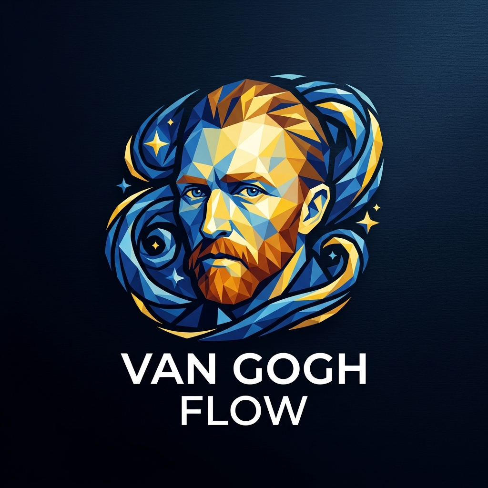
</p>

<h1 align="center">Van Gogh Flow</h1>

<p align="center">
  <b>The 7-Year Evolution of Ambient Desktop Compositing & Flow States</b>
</p>

<p align="center">
  
  
  
  
</p>

---

## 🌌 Overview & Vision

**Van Gogh Flow** is an open-source engineering research and software project created by **Benjamin Pritchard** ([Kundalini Software](https://www.kundalinisoftware.com/van-gogh-flow/)).

It explores the intersection of two distinct domains:
1. **The Psychology of Human Flow States**: Modulating between *focused-mode execution* and *diffuse-mode creative ideation* using subtle, organic peripheral motion inspired by Vincent van Gogh's rhythmic brushstrokes (*The Starry Night*).
2. **Display Server Compositing**: Interfacing directly with operating system window managers (Win32 DWM, Linux X11, Wayland Layer Shell, macOS Quartz/WindowServer, and upcoming STM32MP2 hardware silicon) to guarantee **100% click-through, non-interfering GPU surfaces**.

Over the course of seven years (2019–2026), Van Gogh Flow evolved through **four complete software iterations**, progressing from heavy browser wrappers streaming YouTube videos to ultra-lean native procedural GPU shaders running at native monitor refresh rates.

---

## 🧠 Flow States & Brain Modes: Modulating Attention

In technical problem-solving—whether composing counterpoint, designing hardware board support packages (BSPs), or writing systems software—the brain relies on two alternating modes of cognition:

* **Focused Mode**: Characterized by tight analytical focus within the prefrontal cortex. You are actively stepping through registers, tracking pointer lifetimes, or diagnosing logic bugs.
* **Diffuse Mode**: Characterized by resting-state, panoramic neural network activation. The mind steps back, connects disparate concepts, perceives big-picture architectures, and synthesizes novel breakthroughs.

<p align="center">
  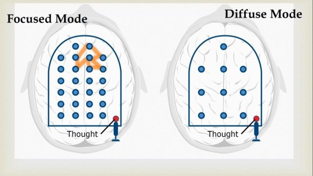
  <br />
  <em>Figure 1: Neural activation patterns between Focused Mode (pinball ricochets tightly localized) and Diffuse Mode (wide exploratory subconscious associations across the entire brain). From Kundalini Software research archives.</em>
</p>

### The "Volume Keys" Metaphor
Rather than requiring the user to switch apps, minimize windows, or look away from their work, Van Gogh Flow treats screen opacity like an audio volume dial:
* **Hyper-Focused Execution**: Dial opacity down (2% – 5%) or toggle off. The screen remains crisp and distraction-free.
* **Diffuse Ideation & Problem-Solving**: Dial opacity up (15% – 30%). The workspace softens into swirling cosmic plasma ribbons and gentle celestial particles, relaxing hyper-vigilance and stimulating associative thinking.

---

## 🖥️ What is a Compositor? (And Why Windowing Architecture Matters)

To understand how Van Gogh Flow works under the hood, it helps to understand how graphical user interfaces have fundamentally changed over the past two decades.

### Legacy Windowing: Shared Framebuffers & Redraw Storms (Win32 & Classic X11)
In classical windowing systems (Win32 Windows 95 through XP, and non-composited X11):
* Windows painted their pixels directly into a **shared screen buffer**.
* When you moved, dragged, or resized a window, the OS calculated "dirty regions" and bombarded obscured windows with redraw messages (`WM_PAINT`, `InvalidateRect`, or X11 `Expose` events).
* If a program locked up or lagged, it missed redraw messages—producing the infamous **"Windows Solitaire trail"** smeared across the screen.
* Full-screen desktop transparency was practically impossible without severe CPU thrashing and visual tearing.

### Modern Compositors: 3D Scene Directors (Wayland, macOS Quartz, Windows DWM)
Modern desktop environments completely inverted this model:
* **Every application renders into its own private, off-screen GPU texture.** No program ever draws into another's memory.
* The **Compositor** acts like a real-time 3D game engine. Every VSync tick (60Hz, 120Hz ProMotion, 144Hz+), it takes all off-screen textures, arranges them in 3D layers, blends them using GPU hardware alpha channels, and presents the composite frame to the monitor.
* **Result**: Zero tearing, zero redraw storms, and zero ghosting.

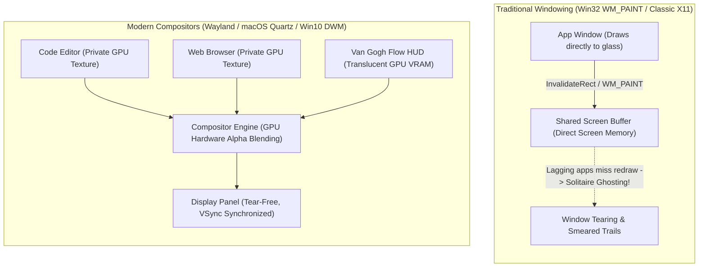

Because modern display servers natively blend off-screen textures on the GPU, **Van Gogh Flow** can float full-screen visualizers across your entire desktop with absolute transparency, native display refresh rates, and zero disruption to the applications underneath.

---

## 🎨 The Four Completed Iterations

```mermaid
flowchart LR
    subgraph I1["1st Iteration (2019)<br/>VanGoghFlow"]
        direction TB
        A1["Windows 10 DWM"]
        A2["WS_EX_TRANSPARENT"]
        A3["CefSharp / CEF"]
        A4["YouTube Streams"]
    end

    subgraph I2["2nd Iteration (2021)<br/>VanGoghFlowGTK3"]
        direction TB
        B1["Linux X11 Compositors"]
        B2["GTK3 + WebKit2GTK"]
        B3["Cairo Input Shapes"]
        B4["libappindicator3 Tray"]
    end

    subgraph I3["3rd Iteration (2026)<br/>vangoghflow_wayland"]
        direction TB
        C1["Direct Wayland Client"]
        C2["zwlr_layer_shell_v1"]
        C3["Native EGL & GLES2"]
        C4["Procedural GLSL Shaders"]
    end

    subgraph I4["4th Iteration (2026)<br/>VanGoghFlow_macOS"]
        direction TB
        D1["AppKit & Quartz Engine"]
        D2["ignoresMouseEvents = YES"]
        D3["Native Apple Metal MSL"]
        D4["Spaces-Persistent HUD"]
    end

    I1 -->|"Port to Linux"| I2
    I2 -->|"AI Leap (Gemini)"| I3
    I3 -->|"Cross-Platform Port (Gemini)"| I4
```

### 1. Iteration 1: [VanGoghFlow (Windows 10)](https://github.com/BenjaminPritchard/VanGoghFlow) — June 2019
* **Platform**: Windows 10 (64-bit)
* **Language & Windowing**: C# (.NET Framework 4.7.2), WinForms, Win32 API
* **Renderer**: CefSharp wrapper around the Chromium Embedded Framework (CEF)
* **Author**: Handcrafted by **Benjamin Pritchard**
* **Click-Through Mechanism**: Overrode `CreateParams` with Win32 extended window styles:
  ```csharp
  cp.ExStyle |= 0x80000;  /* WS_EX_LAYERED     */
  cp.ExStyle |= 0x20;     /* WS_EX_TRANSPARENT */
  cp.ExStyle |= 0x80;     /* WS_EX_TOOLWINDOW  */
  ```
* **Controls**: Global hotkeys via Win32 `RegisterHotKey`: `Ctrl+Alt+N`/`P` (next/prev video), `Ctrl+Alt+I`/`D` (opacity up/down).

### 2. Iteration 2: [VanGoghFlowGTK3 (Linux X11)](https://github.com/BenjaminPritchard/VanGoghFlowGTK3) — August 2021
* **Platform**: Linux (X11 with compositing window managers: Muffin, Compiz, Mutter)
* **Language & Framework**: Pure C (C11), Clang, GTK+ 3.0, WebKit2GTK (`webkit2gtk-4.0`)
* **Author**: Handcrafted by **Benjamin Pritchard**
* **Click-Through Mechanism**: Configured RGBA visual support via `gdk_screen_get_rgba_visual()` and masked input via Cairo:
  ```c
  cairo_rectangle_int_t rect = {0, 0, 0, 0};
  cairo_region_t *shape = cairo_region_create_rectangle(&rect);
  gdk_window_input_shape_combine_region(gdk_window, shape, 0, 0);
  cairo_region_destroy(shape);
  ```
* **Controls**: Global XInput keyboard hooks (`F3`/`F4` as opacity volume keys) and `libappindicator3` system tray menu.

### 3. Iteration 3: [VanGoghFlow_Wayland (Linux Wayland)](https://github.com/BenjaminPritchard/VanGoghFlow_Wayland) — October 2026
* **Platform**: Linux Wayland (wlroots compositors: Wayfire, Sway, Hyprland, Labwc)
* **Language & Architecture**: Modern C++ (C++17), Direct Wayland Client, EGL, OpenGL ES 2.0
* **Author**: Co-Engineered by **Benjamin Pritchard & Google Gemini** (1-Day Generation)
* **Key Breakthroughs**:
  * **Discarded Web Engines Entirely**: Replaced Chromium/WebKit and YouTube video network streams with pure, mathematical GLSL fragment/vertex shaders running at native monitor refresh rates with < 25 MB RAM.
  * **`zwlr_layer_shell_v1` Protocol**: Binds directly to `ZWLR_LAYER_SHELL_V1_LAYER_OVERLAY`, sitting above all tiled, floating, and fullscreen windows.
  * **100% Click-Through Guarantee**: Bypasses UI toolkits (GTK/Qt) that overwrite input masks during layout passes. Interfacing directly with `wayland-client` allows setting a permanent empty `wl_region` (`wl_surface_set_input_region(surface, empty_region)`).

### 4. Iteration 4: [VanGoghFlow_macOS (macOS)](https://github.com/BenjaminPritchard/VanGoghFlow_macOS) — October 2026
* **Platform**: macOS 12 Monterey through macOS 15+ Sequoia (Apple Silicon & Intel)
* **Language & Framework**: Objective-C++ / Modern C++17, AppKit, Apple Metal, MetalKit, QuartzCore
* **Author**: Co-Engineered by **Benjamin Pritchard & Google Gemini** (Same-Day Generation)
* **Key Breakthroughs**:
  * **Native Apple Metal Pipeline**: Procedural shaders execute directly on Apple Silicon unified memory with synchronized ProMotion (120Hz) frame pacing.
  * **WindowServer Click-Through**: Enforces `[window setIgnoresMouseEvents:YES]` at the window server level. Every pointer event falls through without waking the HUD.
  * **Spaces Persistence**: Configured with `NSWindowCollectionBehaviorCanJoinAllSpaces | NSWindowCollectionBehaviorStationary`. The HUD remains pinned across virtual desktop swipes and Exposé/Mission Control transitions.
  * **Runtime MSL Compilation**: Compiles shaders in memory via `newLibraryWithSource:options:error:`, enabling zero-dependency command-line builds.

---

## ⚡ Handwritten Foundations vs. AI-Generated Velocity

The architectural progression across the four generations highlights a remarkable paradigm shift in software development:

* **Iterations 1 & 2 (2019 & 2021)**: Handcrafted line-by-line over weeks of research. Benjamin navigated undocumented Win32 extended window quirks, deciphered Cairo XFixes shape combine algorithms, and packaged heavy web runtimes.
* **Iterations 3 & 4 (October 2026)**: **Conceived, architected, and fully generated in a single day using Google Gemini**. Because Benjamin possessed deep foundational knowledge of compositing managers, layer shell protocols, and graphics pipelines, he was able to guide Gemini to synthesize two complete, robust native systems binaries (Wayland C++/GLES2 and macOS Objective-C++/Metal) in less than 24 hours.

---

## 🔌 The Modular Plugin Architecture

Both the Wayland and macOS implementations share an extensible, self-registering plugin architecture:

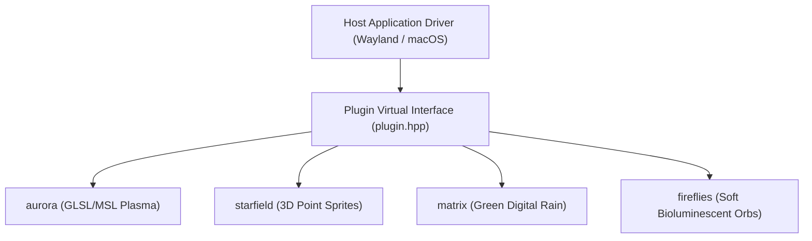

Every plugin implements three lifecycle methods:
1. `bool init(int width, int height)`: Compiles GPU shaders and initializes geometry buffers.
2. `void resize(int width, int height)`: Adjusts viewports and updates resolution uniforms.
3. `void render(float dt, float master_opacity)`: Clears background with `(0, 0, 0, 0)` alpha and dispatches procedural shader passes.

Self-registration into the global registry occurs automatically at static initialization via `REGISTER_PLUGIN(MyPluginClass)`.

---

## 🌠 Visualizer Showcase

<p align="center">
  
  <br />
  <em>Real-time screen capture of Van Gogh Flow cycling through plugins over a Linux Wayland desktop</em>
</p>

<p align="center">
  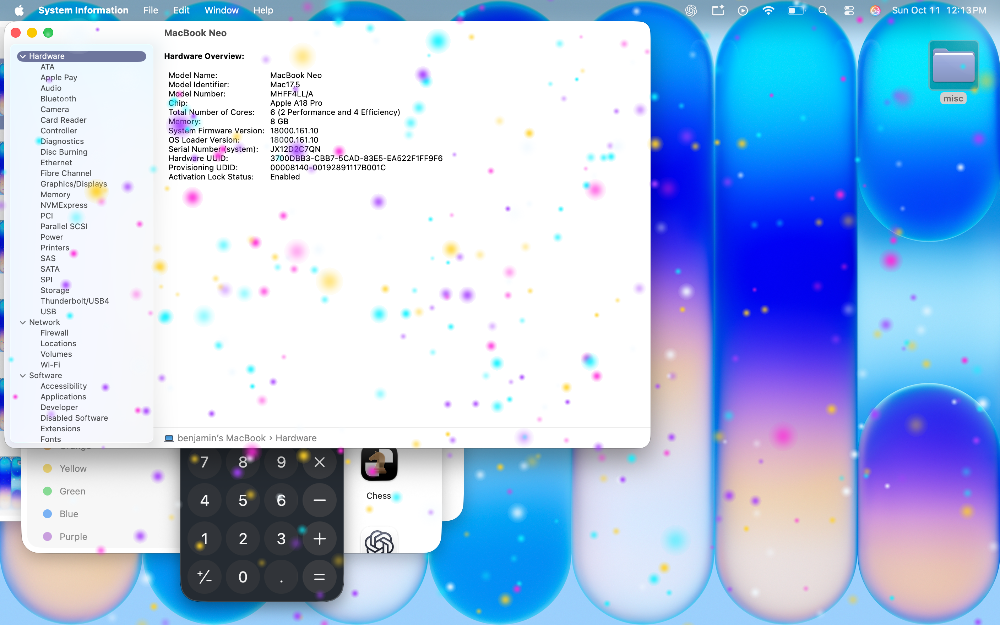
  <br />
  <em>Real-time capture of Van Gogh Flow running transparently across macOS with Apple Metal shaders</em>
</p>

| Plugin | Screenshot | Aesthetic Description |
| :--- | :---: | :--- |
| **`aurora`** | 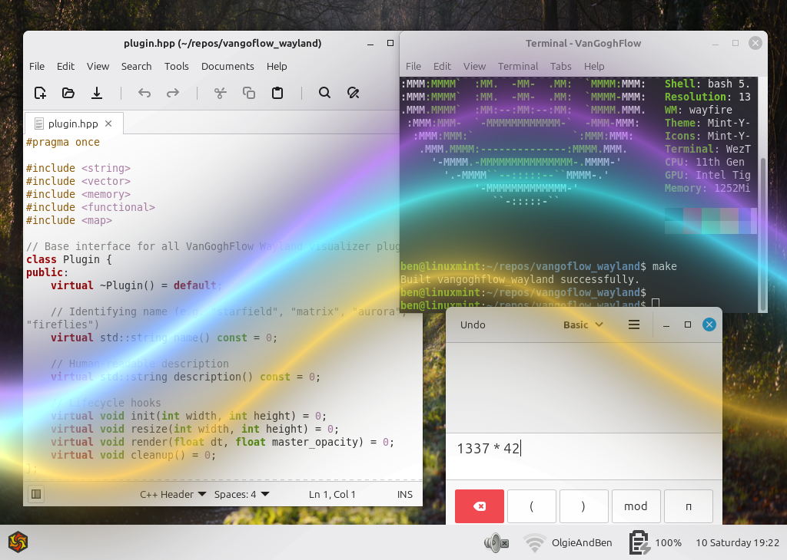 | Flowing cosmic plasma ribbons and undulating waves inspired by Vincent van Gogh's *The Starry Night*. |
| **`starfield`** | 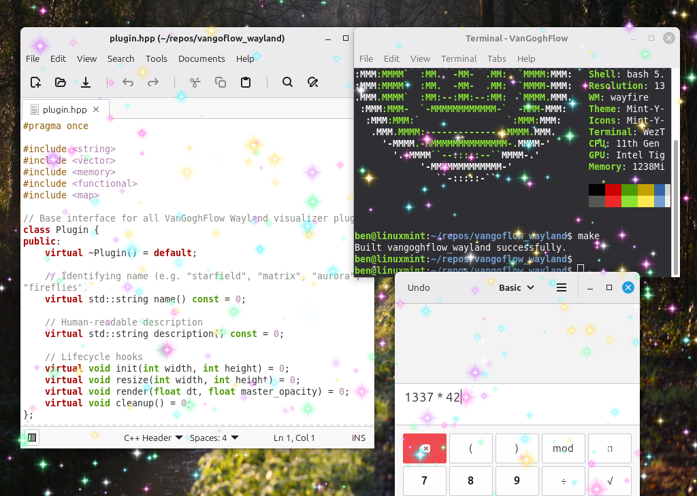 | 3D warp-speed particles with multi-colored twinkling point sprites accelerating toward the viewer. |
| **`matrix`** | 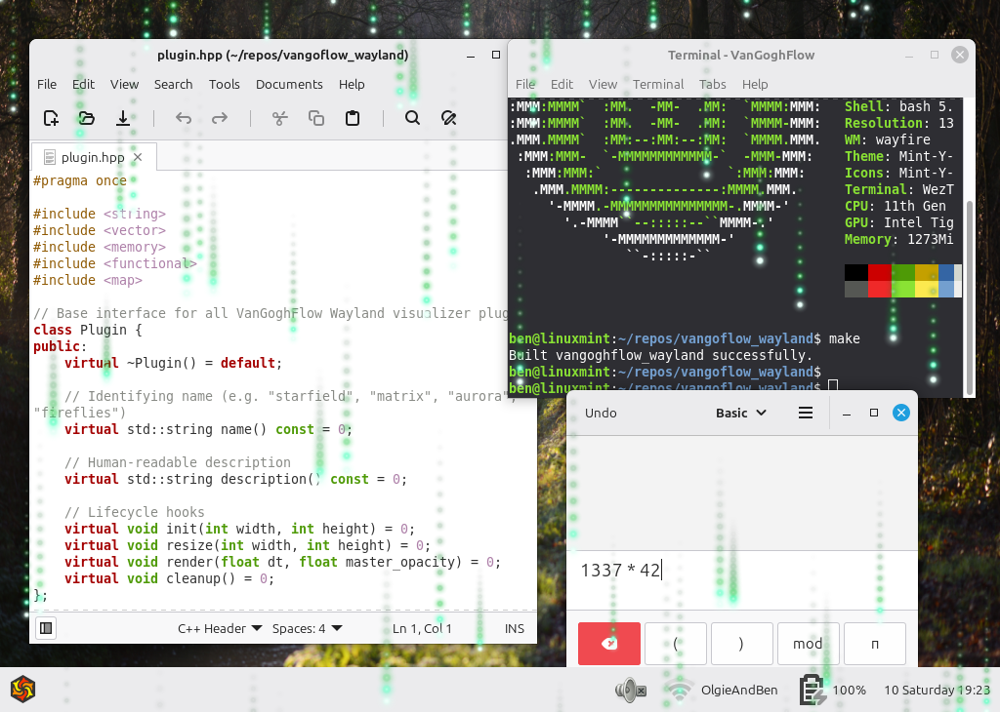 | Cyberpunk digital rain cascades with glowing phosphor-green trails and leading glyphs. |
| **`fireflies`** | 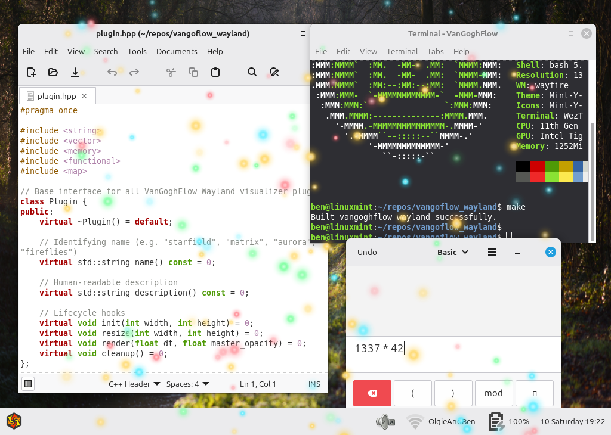 | Luminous drifting bioluminescent particles and floating neon embers with soft radial halos. |

---

## 📊 Comprehensive Comparison Matrix

| Feature | Iteration 1 (2019)<br/>Windows | Iteration 2 (2021)<br/>Linux GTK3 | Iteration 3 (2026)<br/>Wayland | Iteration 4 (2026)<br/>macOS | Iteration 5 (Next)<br/>STM32MP2 Embedded |
| :--- | :--- | :--- | :--- | :--- | :--- |
| **Operating System** | Windows 10 (64-bit) | Linux (X11) | Linux (Wayland) | macOS 12+ | Embedded Linux + Bare Metal |
| **Language** | C# (.NET 4.7.2) | Pure C (C11) | Modern C++ (C++17) | Objective-C++ / C++17 | C/C++ (Linux) + Bare Metal C (M33) |
| **Authoring** | Handcrafted | Handcrafted | **AI-Generated in 1 day** | **AI-Generated in 1 day** | Embedded Systems Engineering |
| **Graphics Engine** | Chromium (CefSharp) | WebKit2GTK | EGL + OpenGL ES 2.0 | Apple Metal (MSL) | Silicon LTDC Layers + LVDS/DSI |
| **Visual Source** | YouTube Streams | YouTube Streams | Procedural GLSL Shaders | Procedural Metal Shaders | Real-time Heterogeneous Planes |
| **Compositor Target** | Windows DWM | Muffin / Compiz / Mutter | `zwlr_layer_shell_v1` | Quartz / WindowServer | Hardware LTDC Scan-Out (RIF) |
| **RAM Footprint** | ~350 MB | ~280 MB | **< 25 MB** | **< 35 MB** | **Zero Linux GPU Overhead** |
| **Binary Size** | ~120 MB | ~65 MB | **< 250 KB** | **< 300 KB** | Microcontroller footprint |
| **Input Pass-Through** | `WS_EX_TRANSPARENT` | Cairo Shape Combine | Direct Empty `wl_region` | `ignoresMouseEvents = YES` | Physical Display Hardware Planes |

---

## 🚀 What's Next: Embedded Linux & Real-Time Multicore Compositing on STM32MP2

The upcoming fifth iteration transitions Van Gogh Flow from personal computers to dedicated industrial microprocessors: **the STMicroelectronics STM32MP2 platform** (specifically the STM32MP25 family).

This edition bridges Benjamin Pritchard's core technical backgrounds:
* **Embedded Linux Engineering**: Mainline kernel drivers, Yocto/Buildroot BSPs, OpenSTLinux, and Wayland/Weston graphics stacks.
* **Deterministic Real-Time Firmware**: Bare-metal Arm Cortex-M firmware, low-latency interrupt handling, and motor/instrumentation control.
* **Hardware Compositing**: Utilizing on-chip display controllers to composite heterogeneous processor streams in silicon.

### Hardware Compositing via LTDC & RIF (Resource Isolation Framework)
On the STM32MP2, a dual-core **64-bit Arm Cortex-A35** application processor runs alongside a dedicated **400 MHz Arm Cortex-M33** real-time secure microcontroller.

Rather than running complex software frame-buffer copying between cores, the **LCD-TFT Display Controller (LTDC)** composites display layers **directly in silicon**:

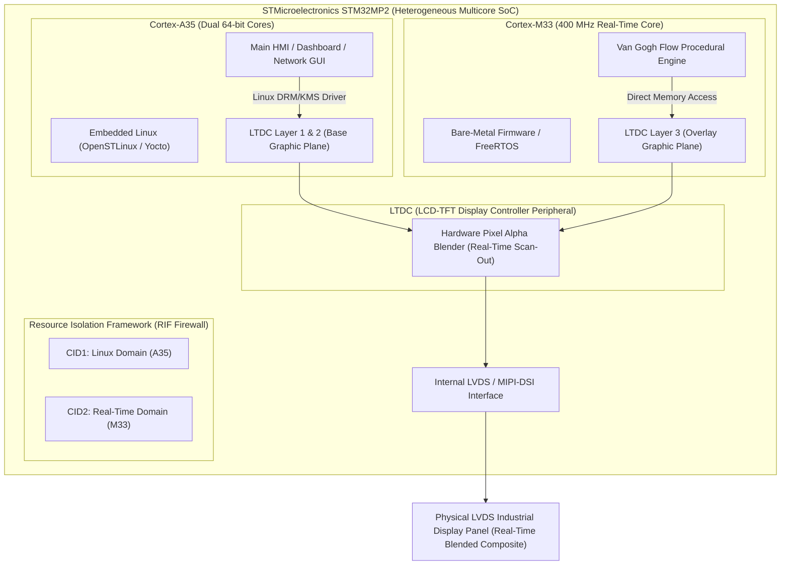

1. **Hardware Layer Allocation**:
   * **Cortex-A35 (Linux)** drives the primary HMI application (system dashboards, network metrics) mapped to LTDC Layers 1 and 2.
   * **Cortex-M33 (Bare Metal)** drives the Van Gogh Flow procedural overlay mapped to LTDC Layer 3.
2. **RIF Hardware Firewalls**:
   * The STM32MP2's **Resource Isolation Framework (RIF)** enforces hardware peripheral isolation using Context Identification (CID1 for Cortex-A35, CID2 for Cortex-M33).
   * RIF grants exclusive hardware ownership of Layer 3 registers and designated SRAM/DDR framebuffers to the M33, preventing Linux processes from modifying or corrupting the real-time layer.
3. **Zero-Jitter Silicon Blending**:
   * The LTDC hardware blends both streams in real-time during raster scan-out to the internal LVDS display interface.
   * Even if Embedded Linux experiences 100% CPU spikes or kernel latency, the M33's ambient flow visualizer updates deterministically at real-time speeds with zero dropped frames.

*Coming soon: Firmware repositories, LTDC device tree overlays, and benchmarks on STM32MP2 evaluation boards.*

---

## 📜 Repositories & Credits

* **Wayland Edition**: [BenjaminPritchard/VanGoghFlow_Wayland](https://github.com/BenjaminPritchard/VanGoghFlow_Wayland)
* **macOS Edition**: [BenjaminPritchard/VanGoghFlow_macOS](https://github.com/BenjaminPritchard/VanGoghFlow_macOS)
* **Linux GTK3 Edition**: [BenjaminPritchard/VanGoghFlowGTK3](https://github.com/BenjaminPritchard/VanGoghFlowGTK3)
* **Windows 10 Original**: [BenjaminPritchard/VanGoghFlow](https://github.com/BenjaminPritchard/VanGoghFlow)
* **Portfolio Showcase**: [BenjaminPritchard.github.io](https://benjaminpritchard.github.io/)

### License
All Van Gogh Flow projects are licensed under the **MIT License**.
Copyright &copy; 2019–2026 **Benjamin Pritchard** / Kundalini Software.
